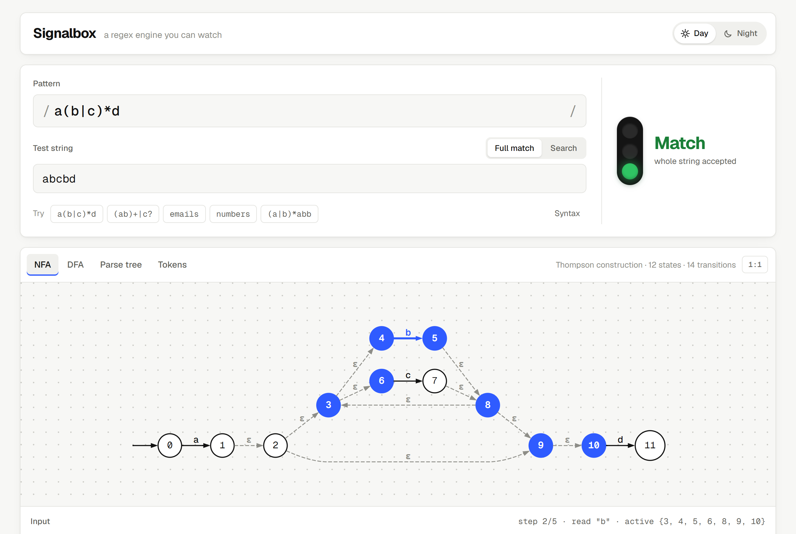

# Signalbox: a regex engine you can watch

A regular-expression engine written from scratch in Python, with a web UI that shows its internals. Type a pattern and watch the parser build the tree and the automaton get drawn. Type a string and step through the simulation, watching which states are active at each character.



The URL keeps the pattern, string, mode and tab, so you can share a view by copying the address bar.

## What it shows

| View | What you see |
|---|---|
| **NFA** | The Thompson-construction automaton. States lit by the simulation and the tracks taken on the last character are highlighted. |
| **DFA** | The subset-construction DFA after Moore minimization. Hover a state to see which NFA states it stands for. |
| **Parse tree** | The AST from the recursive-descent parser, built live node by node in the order the parser creates them. Each new node's slice of the pattern is highlighted. |
| **Tokens** | Tokenizer output, including the implicit concatenation tokens. |

- **Full match** mode answers "does the whole string match?"
- **Search** mode highlights every leftmost-longest match and shows where each one ends.
- Syntax errors point at the exact character that caused them.

## Supported syntax

| Syntax | Meaning |
|---|---|
| `abc` | literal characters (any printable character) |
| `.` | any character except newline |
| `[a-z]`, `[^0-9]` | character classes, ranges, negation |
| `\d \w \s` / `\D \W \S` | digit, word and whitespace classes, and their negations |
| `\n \t \. \* \(` … | escapes |
| `*` `+` `?` | zero or more, one or more, optional |
| `a\|b` | alternation |
| `( )` | grouping, including empty groups and empty alternatives |

Not supported: anchors (`^ $`), counted repetition (`{n,m}`), lazy quantifiers and backreferences.

## How it works

```
pattern ──► tokenizer ──► parser ──► Thompson NFA ──► simulation (match / search / trace)
             (CharSets,    (recursive    │
              implicit      descent,     └──► subset construction ──► Moore minimization ──► DFA
              concat)       AST)
```

- `regex_engine/tokenizer.py` turns the pattern into tokens. Every literal, `.`, escape or `[...]` becomes a `CharSet` (sorted codepoint ranges). Implicit concatenation is inserted as explicit `CONCAT` tokens.
- `regex_engine/parser.py` is a recursive-descent parser with precedence `|` < concat < postfix. It raises `RegexSyntaxError(message, position)`.
- `regex_engine/nfa.py` implements Thompson construction. State IDs are numbered from 0 for each pattern.
- `regex_engine/matcher.py` covers ε-closure and move, full match, leftmost-longest search, and step-by-step traces.
- `regex_engine/dfa.py` builds the DFA. The alphabet is split into disjoint codepoint intervals, so classes like `[^a]` work across all of Unicode. Subset construction is followed by Moore partition refinement.
- `app/server.py` is a FastAPI app with a single `POST /api/analyze` endpoint that also serves the static frontend in `app/static/`. Graphs are sent as Graphviz DOT and rendered in the browser with [viz-js](https://github.com/mdaines/viz-js).

### Use it as a library

```python
import regex_engine

rx = regex_engine.compile(r"[a-z]+@[a-z]+\.com")
rx.fullmatch("ada@lovelace.com")          # True
rx.findall("mail ada@x.com or al@y.com")  # ['ada@x.com', 'al@y.com']
rx.dfa.num_states                         # minimized DFA size
```

## Run locally

```bash
pip install -r requirements-dev.txt
python main.py                 # http://127.0.0.1:8000
python main.py "a(b|c)*d" abcbd   # quick CLI check
pytest -q                      # tests, including a fuzz test against Python's re
```

## Deploy

The repo includes a `Dockerfile` and a `render.yaml`:

- **Render**: create a new Blueprint from this repo (or a Web Service using the Dockerfile). The health check is `/api/health`.
- **Anywhere with Docker**: `docker build -t signalbox . && docker run -p 8000:8000 signalbox`. The app listens on `$PORT`.

Limits per request: pattern ≤ 200 characters, text ≤ 2000 characters, and the DFA stops at 300 states (shown as truncated).

## Tests

`tests/test_differential.py` checks the engine against Python's `re.fullmatch` on a set of hand-picked patterns and 300 randomly generated ones, over every string up to length 4 on `{a, b, c}`. It also checks that the NFA and the minimized DFA agree on every string.
